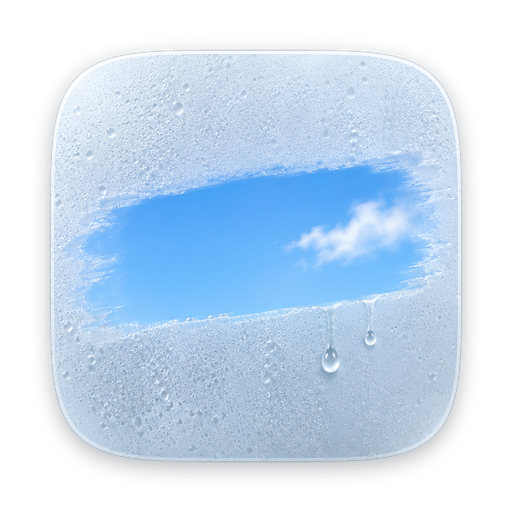
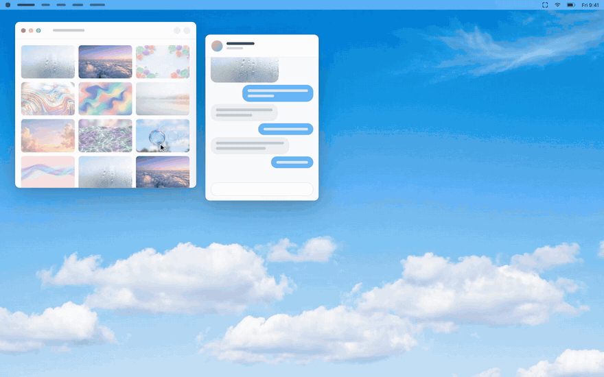

<h1 align="center">Kadr</h1>

<strong>Screenshots and screen recording for Mac</strong>

<a href="https://getkadr.app">Website</a> · <a href="https://api.getkadr.app/buy">Buy</a> · <a href="https://api.getkadr.app/download/latest/mac">Download for Mac</a> · <a href="https://github.com/deeflect/kadr/issues/new?template=bug_report.yml">Report a bug</a> · <a href="https://github.com/deeflect/kadr/issues/new?template=feature_request.yml">Request a feature</a>

 

Kadr is a native macOS menu-bar app for screenshots, screen recording and markup. It runs on Apple silicon Macs with macOS 13 or later and costs $9.99, paid once.

## Features

### Four capture modes
Capture an area, a window or the full screen with one shortcut. Scrolling capture is included too.

### Screen recording
Record the screen and stop from the menu bar. Output is GIF or video.

### Markup tools
Mark up a capture with arrows, shapes, text and blur.

### Copy, drag or pin
Copy a capture, drag it where you need it or pin it, all from the corner. Earlier captures stay in your history.

### OCR and cutout
Kadr includes OCR and cutout tools.

## Download

Kadr is a $9.99 one-time purchase, available at [getkadr.app](https://getkadr.app). It needs an Apple silicon Mac running macOS 13 or later. The download is signed.

## Questions

### How much does Kadr cost?
Kadr costs $9.99, paid once.

### Which Macs does Kadr run on?
Kadr runs on Apple silicon Macs with macOS 13 or later.

### Does Kadr upload my captures?
No. Kadr has no cloud upload.

## Feedback

I want to hear about bugs and missing features. [Report a bug or ask for a feature](https://github.com/deeflect/kadr/issues) on GitHub, and include the app version, the system version and the steps that lead to the bug. I read every issue.

## Made by

Kadr is made by [Dee (deeflect)](https://deeflect.com), a one-person studio.
